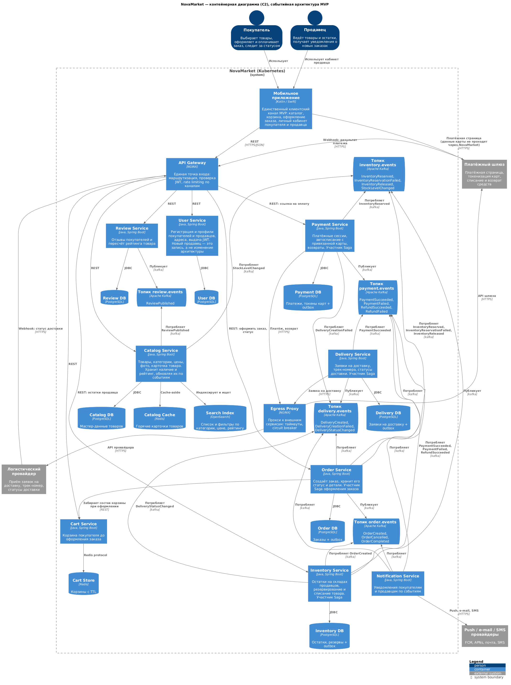

# Задание 1. Приложение на базе EDA

Артефакты:

| Что | Исходник | Картинка |
| :- | :- | :- |
| Контейнерная диаграмма (C2) | [c2-eda.puml](c2-eda.puml) | [c2-eda.png](c2-eda.png) |
| Реестр событий Saga | [ниже](#часть-2-saga-оформления-заказа) | — |
| Sequence: успешное оформление | [saga-1-success.puml](saga-1-success.puml) | [saga-1-success.png](saga-1-success.png) |
| Sequence: товара нет в наличии | [saga-2-inventory-failed.puml](saga-2-inventory-failed.puml) | [saga-2-inventory-failed.png](saga-2-inventory-failed.png) |
| Sequence: оплата не прошла | [saga-3-payment-failed.puml](saga-3-payment-failed.puml) | [saga-3-payment-failed.png](saga-3-payment-failed.png) |
| Sequence: доставку не создать | [saga-4-delivery-failed.puml](saga-4-delivery-failed.puml) | [saga-4-delivery-failed.png](saga-4-delivery-failed.png) |

## Часть 1. Событийная архитектура



### Микросервисы

Границы сервисов проведены по бизнес-возможностям из сценариев: каждый сервис владеет своими данными, другие сервисы узнают о его изменениях только из событий.

| Сервис | Назначение | Данные | Публикует |
| :- | :- | :- | :- |
| **API Gateway** (NGINX) | Единая точка входа для мобильного приложения и webhook'ов внешних систем: маршрутизация, проверка JWT, rate limiting по каналам | — | — |
| **User Service** | Регистрация и профили покупателей и продавцов, адреса доставки, выдача JWT. Новый продавец — это запись в БД с ролью «продавец», архитектура не меняется | PostgreSQL | — |
| **Catalog Service** | Каталог: товары, категории, цены, фото, карточка товара, фильтры по категории, цене и рейтингу. Наличие и рейтинг хранит у себя как копию и обновляет по событиям — карточка не ходит синхронно в склад и отзывы | PostgreSQL, OpenSearch, Redis | — |
| **Review Service** | Отзывы покупателей, пересчёт рейтинга товара | PostgreSQL | `review.events` |
| **Cart Service** | Корзина до оформления заказа | Redis (TTL) | — |
| **Order Service** | Создаёт заказ, ведёт его статус и детали (состав, сумма, адрес, способ доставки, трек-номер). Участник Saga | PostgreSQL + outbox | `order.events` |
| **Inventory Service** | Остатки на складах продавцов, резервирование и списание. Продавец ведёт остатки через свой кабинет. Участник Saga | PostgreSQL + outbox | `inventory.events` |
| **Payment Service** | Платёжные сессии, автосписание по токену привязанной карты, возвраты. Данные карты вводятся на странице шлюза и в NovaMarket не попадают. Участник Saga | PostgreSQL + outbox | `payment.events` |
| **Delivery Service** | Заявки в логистическую службу, трек-номер, статусы доставки из webhook'ов провайдера. Участник Saga | PostgreSQL + outbox | `delivery.events` |
| **Notification Service** | Push, e-mail и SMS покупателям и продавцам. Ничего не публикует, только слушает | — | — |
| **Egress Proxy** (NGINX) | Все вызовы к внешним сервисам: таймауты, circuit breaker | — | — |

### Почему потоки событий нарисованы через топики (вариант 1)

Почти каждое событие потребляют несколько сервисов. Например, `PaymentSucceeded` слушают Order, Inventory, Delivery и Notification. При прямых стрелках «сервис → сервис» одно событие превратилось бы в четыре стрелки, а новый подписчик (аналитика, антифрод, рекомендации) — в правку диаграммы у издателя. Поэтому топики Kafka показаны отдельными контейнерами: издатель пишет в свой топик и не знает подписчиков.

### Топики

| Топик | Владелец (единственный издатель) | События | Подписчики |
| :- | :- | :- | :- |
| `order.events` | Order Service | `OrderCreated`, `OrderCancelled`, `OrderCompleted` | Inventory, Notification |
| `inventory.events` | Inventory Service | `InventoryReserved`, `InventoryReservationFailed`, `InventoryReleased`, `StockLevelChanged` | Order, Payment, Catalog |
| `payment.events` | Payment Service | `PaymentSucceeded`, `PaymentFailed`, `RefundSucceeded`, `RefundFailed` | Order, Inventory, Delivery, Notification |
| `delivery.events` | Delivery Service | `DeliveryCreated`, `DeliveryCreationFailed`, `DeliveryStatusChanged` | Order, Payment, Inventory, Notification |
| `review.events` | Review Service | `ReviewPublished` | Catalog |

Вне Saga:
- `StockLevelChanged` обновляет наличие в каталоге. Так выполняется требование бизнеса: товар, которого нет на складе, не продаётся как доступный.
- `ReviewPublished` пересчитывает рейтинг для фильтров.
- `DeliveryStatusChanged` двигает статусы «Передан в доставку» → «Доставлен». При передаче курьеру Inventory окончательно списывает зарезервированный товар.
- `OrderCompleted` закрывает заказ после доставки.

### Общие правила обмена событиями

- **Ключ сообщения — `orderId`** (для `StockLevelChanged` — `productId`). Все события одного заказа попадают в одну партицию и обрабатываются по порядку.
- **Transactional outbox.** Сервис меняет свои данные и пишет событие в таблицу outbox одной транзакцией. Отдельный процесс (Debezium или поллер) переносит события в Kafka. Не бывает «заказ сохранён, а событие потерялось» и наоборот.
- **Идемпотентные потребители.** Kafka гарантирует доставку «хотя бы один раз». Каждое событие несёт `eventId`, обработанные id хранятся в таблице `processed_events` в той же транзакции, что и изменение данных. Повтор просто пропускается.
- **Ретраи и DLQ.** Временные ошибки повторяются с паузой. Сообщение, которое не удалось обработать за N попыток, уходит в `<topic>.dlq`, срабатывает алерт.
- **Контракты событий** — Avro/Protobuf в Schema Registry с проверкой обратной совместимости. Новые поля добавляются, старые не удаляются.
- **Новые сервисы подключаются подпиской.** Аналитика, антифрод, рекомендации, программа лояльности заводят свою consumer group на нужные топики. Издатели при этом не меняются.

### Как архитектура отвечает требованиям

| Требование | Решение |
| :- | :- |
| Отклик ≤ 0,3 с (p98) и ≤ 1 с (p99,99) | Каталог читается из Redis и OpenSearch без синхронных вызовов в другие сервисы. Оформление заказа отвечает `202 Accepted` сразу после записи заказа, остальное идёт асинхронно; статус приходит push-уведомлением, приложение также может его запросить |
| 2 500 → 40 000+ заказов в день | Даже 40 000 заказов в день — это в среднем около 0,5 заказа в секунду и порядка 10 событий в секунду; в пиках ×10 это всё ещё мало для Kafka. Узкие места — чтение каталога, оно масштабируется репликами сервиса, Redis и OpenSearch. Сервисы stateless, масштабируются HPA (задание 3) |
| Новый продавец без изменения архитектуры | Продавец — роль в User Service. Его товары и остатки — данные Catalog и Inventory |
| Новые сервисы по подписке на события | Каждый топик принадлежит одному издателю, подписчиков может быть сколько угодно |
| Интеграции с платёжным шлюзом и доставкой | Изолированы в Payment и Delivery, исходящие вызовы идут через egress-прокси с таймаутами и circuit breaker (задание 4). Сбой внешней системы не блокирует остальной сервис |
| Новые каналы (сайт, чат-бот, ассистенты) | Подключаются к тому же API Gateway с отдельными лимитами |
| Мультирегиональность | Сервисы без состояния, данные разделены по сервисам. Kafka и БД реплицируются по регионам (MirrorMaker 2, реплики PostgreSQL) без переделки контрактов |

## Часть 2. Saga оформления заказа

Выбрана **хореография**: оркестратора нет, каждый участник реагирует на события предыдущего шага и сам публикует результат. Участники — Order, Inventory, Payment и Delivery. Notification только слушает.

Порядок шагов выбран из сценария:
1. Order создаёт заказ.
2. Inventory резервирует товар — «чтобы его не купил кто-то другой».
3. Payment списывает деньги. Платёж не начинается, пока товар не зарезервирован, поэтому не приходится возвращать деньги за товар, которого нет.
4. Delivery создаёт заявку у логистического провайдера. Продавец получает уведомление, когда заявка создана.

**Оплата — точка невозврата (pivot transaction).** До неё любая ошибка просто отменяет заказ. После неё бизнес требует: «если покупатель оплатил товар, тот должен быть зарезервирован и доставлен». Поэтому ошибки доставки сначала лечатся повторами (forward recovery), а компенсации с возвратом денег запускаются только если доставка невозможна в принципе.

### Реестр событий

| № | Этап | Тип события | Название | Издатель | Потребители и реакция |
| :-: | :- | :- | :- | :- | :- |
| 1 | Создание заказа | domain | `OrderCreated` | Order | Inventory — резервирует товар; Notification |
| 2 | Успешное резервирование товара | domain | `InventoryReserved` | Inventory | Order — статус «Ожидает оплаты»; Payment — начинает оплату |
| 3 | Ошибка резервирования (нет нужного количества) | failure | `InventoryReservationFailed` | Inventory | Order — отменяет заказ |
| 4 | Успешная оплата | domain | `PaymentSucceeded` | Payment | Order — статус «Оплачен и готовится к отправке»; Inventory — снимает срок истечения с резерва; Delivery — создаёт заявку; Notification |
| 5 | Ошибка оплаты (отказ банка или таймаут 15 минут) | failure | `PaymentFailed` | Payment | Inventory — снимает резерв; Order — отменяет заказ; Notification |
| 6 | Успешное создание заявки на доставку | domain | `DeliveryCreated` | Delivery | Order — сохраняет трек-номер и плановую дату; Notification — уведомляет продавца и покупателя |
| 7 | Ошибка создания заявки на доставку (после повторов) | failure | `DeliveryCreationFailed` | Delivery | Payment — возвращает деньги; Order; Notification |
| 8 | Возврат средств | compensation | `RefundSucceeded` | Payment | Inventory — снимает резерв; Order — отменяет заказ; Notification |
| 9 | Ошибка возврата средств | failure | `RefundFailed` | Payment | Order — статус «Требует внимания поддержки»; Notification — задача поддержке |
| 10 | Снятие резерва товара | compensation | `InventoryReleased` | Inventory | Order — фиксирует в истории заказа |
| 11 | Отмена заказа | compensation | `OrderCancelled` | Order | Notification — сообщает покупателю причину |

### Статусы заказа в Saga

```
Создан ──InventoryReserved──▶ Ожидает оплаты ──PaymentSucceeded──▶ Оплачен и готовится к отправке ──DeliveryCreated──▶ (трек-номер)
  │                              │                                     │
  └─InventoryReservationFailed   └─PaymentFailed                       └─DeliveryCreationFailed → RefundSucceeded
            ▼                              ▼                                           ▼
         Отменён                        Отменён                                     Отменён (деньги возвращены)
                                                                         RefundFailed → Требует внимания поддержки
```

### Сценарии

| Сценарий | Диаграмма | Компенсации |
| :- | :- | :- |
| Успешное оформление | [saga-1-success.png](saga-1-success.png) | — |
| Товара нет в нужном количестве | [saga-2-inventory-failed.png](saga-2-inventory-failed.png) | Только отмена заказа: резерва и платежа ещё нет |
| Оплата отклонена или не пришла за 15 минут | [saga-3-payment-failed.png](saga-3-payment-failed.png) | Снятие резерва, отмена заказа |
| Доставку не удалось создать | [saga-4-delivery-failed.png](saga-4-delivery-failed.png) | Возврат денег, снятие резерва, отмена заказа; если возврат не прошёл — ручная обработка |

### Защита от зависших Saga

- **Резерв товара ограничен 15 минутами.** Если `PaymentSucceeded` не пришёл вовремя, Inventory снимает резерв сам, даже если `PaymentFailed` потерялся.
- **Платёжная сессия тоже ограничена 15 минутами.** По истечении Payment публикует `PaymentFailed` с причиной `TIMEOUT`.
- **Все шаги идемпотентны по `orderId`:**
  - повторный `OrderCreated` не создаёт второй резерв;
  - повторный `PaymentSucceeded` не создаёт вторую заявку на доставку;
  - `POST /orders` принимает `Idempotency-Key`, поэтому двойное нажатие кнопки не создаёт два заказа.
- **Order Service следит за заказами, которые слишком долго стоят в промежуточном статусе,** и поднимает алерт.
