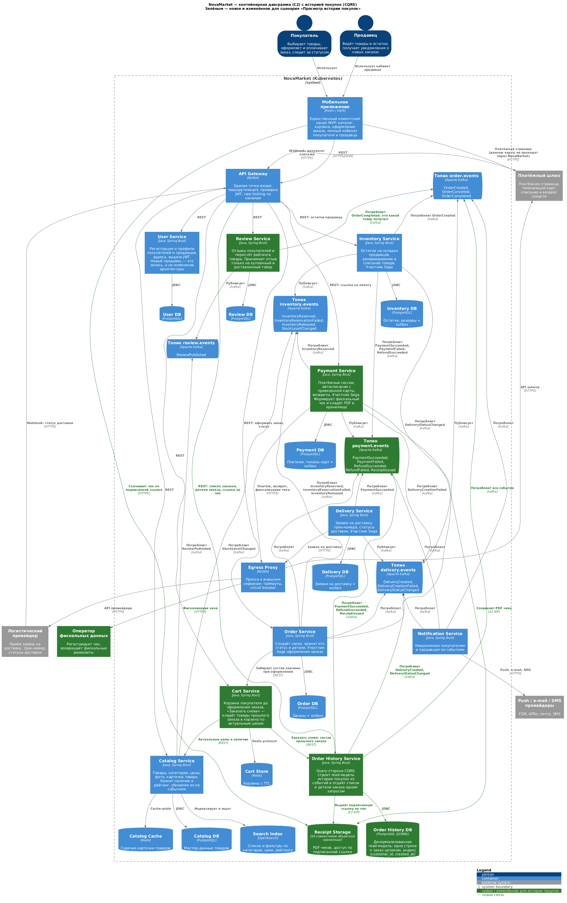

### **Название задачи:** Просмотр истории покупок — получение агрегированных данных заказа на фронтенде
### **Автор:** Михаил Хорсун
### **Дата:** 18.11.2026
### **Функциональные требования**

|**№**|**Действующие лица или системы**|**Use Case**|**Описание**|
| :-: | :- | :- | :- |
|1|Покупатель, мобильное приложение, Order History Service|Просмотр списка заказов|1. Покупатель открывает «Историю покупок» в личном кабинете. 2. Приложение запрашивает `GET /history/orders?cursor=…` через API Gateway. 3. Order History Service одним запросом к своей БД возвращает страницу заказов покупателя от новых к старым: сумма, дата, способ доставки, финальный статус. 4. Приложение подгружает следующую страницу по курсору при прокрутке|
|2|Покупатель, мобильное приложение, Order History Service|Детали заказа|1. Покупатель открывает заказ из списка. 2. Приложение запрашивает `GET /history/orders/{orderId}`. 3. Сервис возвращает заказ целиком из одной строки read-модели: товары (название, фото, количество, цена на момент покупки), итоговая сумма, способ доставки, адрес, трек-номер, способ оплаты (маска карты), финальный статус «Доставлен» или «Отменён» с причиной|
|3|Покупатель, Order History Service, Receipt Storage|Скачать чек|1. Покупатель нажимает «Скачать чек». 2. Приложение запрашивает `GET /history/orders/{orderId}/receipt`. 3. Сервис проверяет, что заказ принадлежит покупателю, и выдаёт подписанную ссылку на PDF в объектном хранилище, живущую 5 минут. 4. Приложение скачивает PDF напрямую из хранилища, файл не проходит через сервисы|
|4|Покупатель, Review Service|Оставить отзыв о товаре|1. Покупатель нажимает «Оставить отзыв» у товара в деталях заказа. 2. Приложение отправляет `POST /reviews` с `orderId` и `productId`. 3. Review Service проверяет по своей копии данных из `OrderCompleted`, что покупатель получил этот товар. 4. Отзыв сохраняется, публикуется `ReviewPublished`, Catalog пересчитывает рейтинг|
|5|Покупатель, Cart Service, Order History Service, Catalog Service|Заказать снова|1. Покупатель нажимает «Заказать снова». 2. Приложение отправляет `POST /cart/reorder {orderId}`. 3. Cart Service берёт состав заказа из Order History Service, а актуальные цены и наличие — из Catalog. 4. Доступные товары попадают в корзину по текущей цене, по недоступным приложение показывает предупреждение. 5. Дальше обычное оформление заказа (Saga из задания 1)|
|6|Order, Payment, Delivery Service, Kafka, Order History Service|Обновление read-модели|1. Сервисы публикуют события, на которые подписан Order History Service: `OrderCreated`, `OrderCancelled`, `OrderCompleted`, `PaymentSucceeded`, `RefundSucceeded`, `ReceiptIssued`, `DeliveryCreated`, `DeliveryStatusChanged`. 2. Order History Service идемпотентно применяет каждое событие к строке заказа. 3. Через доли секунды после события изменение видно в истории|

### **Нефункциональные требования**

|**№**|**Требование**|
| :-: | :- |
|1|Время ответа списка и деталей заказа — не больше 0,3 с для 98% запросов и не больше 1 с для 99,99% запросов|
|2|История покупок работает, даже если Order, Payment или Delivery Service недоступны: просмотр не должен зависеть от сервисов оформления заказа|
|3|Масштабирование вместе с ростом: 2 500 → 40 000+ заказов в день, история растёт неограниченно (миллионы заказов за годы), чтение — частые повторные заходы в личный кабинет|
|4|Допустима eventual consistency: изменение статуса появляется в истории с задержкой до нескольких секунд. Задержка мониторится|
|5|Покупатель видит только свои заказы. Чек отдаётся только владельцу заказа|
|6|Цена и название товара в истории — на момент покупки, а не текущие из каталога|
|7|Новые каналы (сайт, чат-бот, ассистенты) используют тот же API истории без изменений|
|8|Read-модель можно перестроить с нуля (новое поле, ошибка в проекции) без остановки оформления заказов|

### **Решение**

Контейнерная диаграмма с обновлённой архитектурой: [c2-purchase-history.puml](c2-purchase-history.puml) / [c2-purchase-history.png](c2-purchase-history.png). Новое и изменённое выделено зелёным. Контекст системы не изменился, кроме нового внешнего участника — оператора фискальных данных.

**Выбран CQRS: отдельная read-модель истории покупок, которая строится из событий.**

Данные одного заказа после Saga из задания 1 разнесены по четырём сервисам:
- состав и статус — в Order;
- способ оплаты и чек — в Payment;
- трек-номер и факт доставки — в Delivery;
- названия и фото товаров — в Catalog.

Собирать их на каждый запрос дорого и ненадёжно (см. «Альтернативы»). Поэтому чтение истории отделено от записи:

- **Command-сторона не меняется.** Order, Payment и Delivery по-прежнему владеют своими данными и ведут Saga. Добавлено два изменения:
  - `OrderCreated` теперь несёт снимок заказа: позиции с названием, ссылкой на фото, количеством и ценой на момент покупки, сумму, способ доставки, адрес, способ оплаты. Снимок нужен по требованию 6: история не должна ходить в каталог и не должна показывать сегодняшнюю цену;
  - Payment после успешной оплаты фискализирует чек у оператора фискальных данных, кладёт PDF в объектное хранилище и публикует новое событие `ReceiptIssued` с ключом объекта. Это делает отдельный процесс после `PaymentSucceeded`, он не тормозит Saga.
- **Query-сторона — новый Order History Service.**
  - **Подписка на события.** Сервис подписан на `order.events`, `payment.events` и `delivery.events` со своей consumer group. Из каждого события он обновляет одну строку read-модели «заказ целиком».
  - **Хранение.** Строка хранится в PostgreSQL. Поля для списка и сортировки (`customer_id`, `created_at`, `total`, `delivery_method`, `status`) лежат в колонках, детали (позиции, адрес, оплата, трек-номер, ключ чека) — в JSONB.
  - **Чтение.** Индекс `(customer_id, created_at DESC)` отдаёт страницу истории одним index range scan за единицы миллисекунд, детали — по первичному ключу. Синхронных вызовов в другие сервисы при чтении нет.
  - **Порядок и повторы.** Ключ сообщений во всех топиках — `orderId`, поэтому события одного заказа приходят в одну партицию и по порядку. Обработанные `eventId` хранятся в той же транзакции, что и обновление строки, так что повтор события ничего не ломает.
  - **Порядок между топиками** не гарантирован. Например, `DeliveryCreated` может прийти раньше `OrderCreated`, если партиция `order.events` отстаёт. Тогда сервис создаёт строку-заготовку по `orderId` и дополняет её, когда придёт `OrderCreated`. Статус меняется только «вперёд» по жизненному циклу: опоздавшее событие не откатит «Доставлен» назад.
- **Действия из истории — это команды, они идут в сервисы-владельцы.**
  - «Скачать чек» — подписанная ссылка на объект в хранилище, PDF не проходит через сервисы.
  - «Оставить отзыв» — Review Service. Право на отзыв он проверяет по своей проекции `OrderCompleted`, а не синхронным вызовом.
  - «Заказать снова» — Cart Service. Он берёт состав из истории, а цены и наличие — из каталога, потому что в корзине нужны актуальные данные.

**Почему это закрывает требования:**
- **Отклик (НФТ 1):** один индексированный запрос к одной БД без сетевых вызовов. Это единицы-десятки миллисекунд, запас до 0,3 с большой. При росте нагрузки добавляются реплики сервиса и read-реплики PostgreSQL. Горячие первые страницы можно дополнительно кэшировать в Redis, но на старте это не нужно.
- **Независимость (НФТ 2):** при падении Order, Payment или Delivery история продолжает отвечать из своей БД. События накопятся в Kafka и применятся позже.
- **Рост (НФТ 3):** 40 000 заказов в день — это около 15 млн строк в год, для индексированной таблицы PostgreSQL это немного. Когда понадобится, таблица партиционируется по `created_at` или шардируется по `customer_id`: ключ доступа всегда содержит покупателя.
- **Перестройка (НФТ 8):** у топиков длинный срок хранения, проекцию можно перечитать с начала в новую таблицу новой consumer group и переключиться на неё. Для событий старше срока хранения — разовая выгрузка из сервисов-владельцев.
- **Каналы (НФТ 7):** API истории не зависит от клиента, сайт и чат-бот получают тот же JSON через API Gateway.
- **Безопасность (НФТ 5):** `customer_id` берётся из JWT, а не из параметров запроса. Подписанная ссылка на чек выдаётся только после проверки владельца.

**Технологии.**
- **PostgreSQL с JSONB, а не документная БД.** Она уже используется во всех сервисах: команда умеет её эксплуатировать, бэкапы и мониторинг уже есть. JSONB даёт гибкость документа там, где она нужна.
- **Kafka** — уже существующая шина событий.
- **S3-совместимое хранилище** — стандартное место для файлов чеков.

### **Альтернативы**

**1. API Composition.**
Агрегирующий сервис или BFF на каждый запрос истории вызывает Order (список заказов), Payment (оплата и чек), Delivery (доставка) и Catalog (фото), а затем склеивает ответ.

- Плюсы:
  - не нужна отдельная БД и подписка на события;
  - данные всегда самые свежие;
  - быстро сделать.
- Минусы:
  - **Отклик.** Отклик равен отклику самого медленного вызова плюс накладные расходы. Для страницы из 20 заказов это 3–4 сетевых вызова, каждый с пакетом id. Хвост распределения (p99,99 ≤ 1 с) тянется от любого тормозящего сервиса.
  - **Доступность.** Доступность истории равна произведению доступностей четырёх сервисов: при падении Delivery история ломается целиком или показывается частично.
  - **Пагинация.** Пагинацию и сортировку можно делать только по данным Order. Фильтр «доставленные курьером» потребовал бы вытягивать лишнее и фильтровать в памяти.
  - **Нагрузка.** Нагрузка на чтение истории ложится на сервисы оформления заказа, которые должны быть быстрыми прежде всего на Saga.
- Вывод: отклонено как основной способ. Хорошо подходит для одной страницы с данными из 1–2 сервисов, но не для списка, собранного из четырёх.

**2. Event Sourcing для заказа.**
Состояние заказа хранится как последовательность событий в event store, текущее состояние и история восстанавливаются из них.

- Плюсы:
  - полный аудит каждого изменения заказа;
  - можно построить любые новые проекции задним числом;
  - естественно сочетается с CQRS.
- Минусы:
  - Сам по себе не решает задачу: данные оплаты и доставки живут в других сервисах, и для истории всё равно нужна read-модель — то есть тот же CQRS.
  - Требует переделать Order, Payment и Delivery на event store. Нужны снапшоты, версионирование событий навсегда, отладка через «проигрывание» — существенная сложность для команды на этапе MVP.
  - Удаление персональных данных по запросу (152-ФЗ, GDPR) в неизменяемом журнале событий требует отдельных техник (crypto-shredding).
- Вывод: отклонено для MVP. Сервисы публикуют доменные события через outbox (задание 1), поэтому к Event Sourcing можно перейти позже для отдельного сервиса, не меняя Order History Service.

**3. Хранить всё в Order Service и читать с read-реплики.**
Order Service получает события оплаты и доставки, хранит у себя всё для истории и отдаёт историю с read-реплики своей БД.

- Плюсы:
  - нет нового сервиса.
- Минусы:
  - Order Service разрастается чужими данными (чек, способ оплаты, трек-номер) и двумя ответственностями: ведение Saga и витрина для чтения. Их нагрузка и требования к схеме разные.
  - Изменения витрины (новое поле, фильтр, перестройка) затрагивают критичный сервис оформления заказов.
- Вывод: отклонено. Это тот же CQRS, но без разделения ответственности, ради которого он нужен.

### **Недостатки, ограничения, риски**

- **Eventual consistency.**
  - История отстаёт от источников на время доставки события, обычно доли секунды. При отставании consumer'а — дольше.
  - Покупатель может открыть историю сразу после оформления и ещё не увидеть заказ или увидеть старый статус.
  - Митигация:
    - активные заказы и их статус приложение показывает из Order Service (экран «Мои заказы»). История — это прежде всего завершённые заказы;
    - отставание consumer'а (consumer lag) и время от публикации до применения — в метриках с алертом на > 5 секунд.
- **Дублирование данных.** Снимок заказа хранится и в Order, и в истории. Исправление данных (например, опечатка в адресе) должно идти через событие, иначе копии разойдутся. Правка напрямую в БД истории запрещена.
- **Порядок и полнота событий.**
  - Ошибка в обработчике или нарушение контракта может испортить проекцию.
  - Митигация:
    - контракты в Schema Registry с проверкой совместимости;
    - DLQ с алертом;
    - возможность перестроить проекцию с нуля (НФТ 8);
    - периодическая сверка количества и сумм заказов с Order Service.
- **Зависимость от срока хранения Kafka.** Перестроить историю за годы только из топиков нельзя, если срок хранения меньше. Нужен процесс первичной загрузки из сервисов-владельцев, его нужно поддерживать в рабочем состоянии.
- **Изменение контракта `OrderCreated`.** Событие становится больше из-за снимка позиций, и от его формы теперь зависят несколько потребителей. Менять контракт можно только совместимо: новые поля добавляются, старые не удаляются.
- **Ещё один сервис и БД в эксплуатации:** деплой, мониторинг, бэкапы, миграции схемы. Для MVP это оправдано: альтернатива (API Composition) не держит требования к отклику и доступности.
- **Фискализация чека.**
  - Чек появляется в истории только после ответа оператора фискальных данных. Если оператор недоступен, кнопка «Скачать чек» временно неактивна с пояснением.
  - Payment повторяет фискализацию в фоне.
- **Персональные данные.** В read-модели лежат адреса и маски карт. Нужны тот же уровень защиты, что и в источниках, и процедура удаления по запросу покупателя (событие `CustomerDataErased` → очистка строк).
